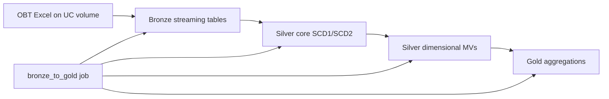
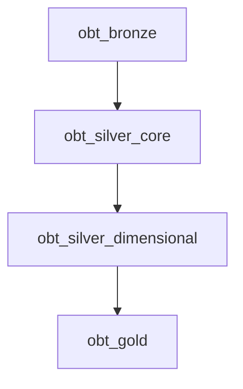

# OBT Ecommerce Medallion on Databricks SDP

**Delivered by:** [Zynx Technologies Ltd](https://www.zynxtechnologies.com/)  
**Portfolio host (pre-fork):** `anoopdk/claudexdatabricks`  
**Domain client (sanitised):** Zynx x Retail Client  
**Engagement type:** Implementation Delivery  
**Portfolio version:** `1.0.0-portfolio`

> Inspection note: Client identity is domain-aliased for public portfolio use. This repository is structured for authenticity review of delivery artefacts, architecture, and engagement scope.

## Project overview

The Retail Client received denormalised One-Big-Table ecommerce Excel extracts and needed a governed Databricks Lakeflow SDP medallion path that splits domains, applies SCD logic, and publishes gold analytics without manual spreadsheet modelling.

### Solution delivered

Zynx implemented Bronze -> Silver Core -> Silver Dimensional -> Gold SDP pipelines with Unity Catalog schemas, expectations, SCD2 dimensions, star-schema facts, and a sequenced job.

## Engagement levels

| # | Level |
| --- | --- |
| 1 | Source Profiling (OBT Excel) |
| 2 | Architecture & Layer Design |
| 3 | SDP Pipeline Implementation |
| 4 | Job Orchestration & Handover |

| Field | Value |
| --- | --- |
| Engagement posture | Delivery portfolio artefact prepared for audit / inspection |
| Confidentiality | Domain alias only; no real client legal name in public docs |
| Primary artefacts | Code/notebooks/docs already in-repo + Zynx standard pack under `docs/` and `decks/` |

## Architecture

### Implementation flow

## Technology stack

`Databricks Lakeflow SDP`, `Unity Catalog`, `Auto Loader / volumes`, `SCD Type 2`, `Python pipelines`, `Asset Bundle resources`

## Repository map

| Path | Purpose |
| --- | --- |
| `README.md` | Project overview + engagement levels |
| `docs/` | Problem, solution, architecture, implementation, runbook, audit factsheet |
| `decks/` | 3-slide delivery overview (Markdown + HTML) |
| `src/` / project subtree | Implementation assets (or placeholders where design-led) |
| `tests/` | Tests or placeholders |
| `scripts/` | Operational / helper scripts |
| `configs/` | Non-secret configuration templates |
| `.env.example` | Environment variable placeholders |

### Key existing delivery paths

- `docs/technical-architecture.md`
- `src/pipelines/`
- `resources/`
- `databricks.yml`

## How to inspect this repository

1. Read this README (overview + engagement).
2. Open `docs/audit/PROJECT-FACTSHEET.md`.
3. Review architecture in `docs/03-architecture.md`.
4. Walk implementation evidence listed in the factsheet.
5. Open `decks/overview.html` for the 3-slide executive summary.

## Related Zynx context

Zynx Technologies Ltd provides IT consulting across cloud, data analytics, and digital delivery. This repository is part of the public delivery portfolio hosted on `anoopdk` prior to organisation-level fork.

## License

See `LICENSE`.
