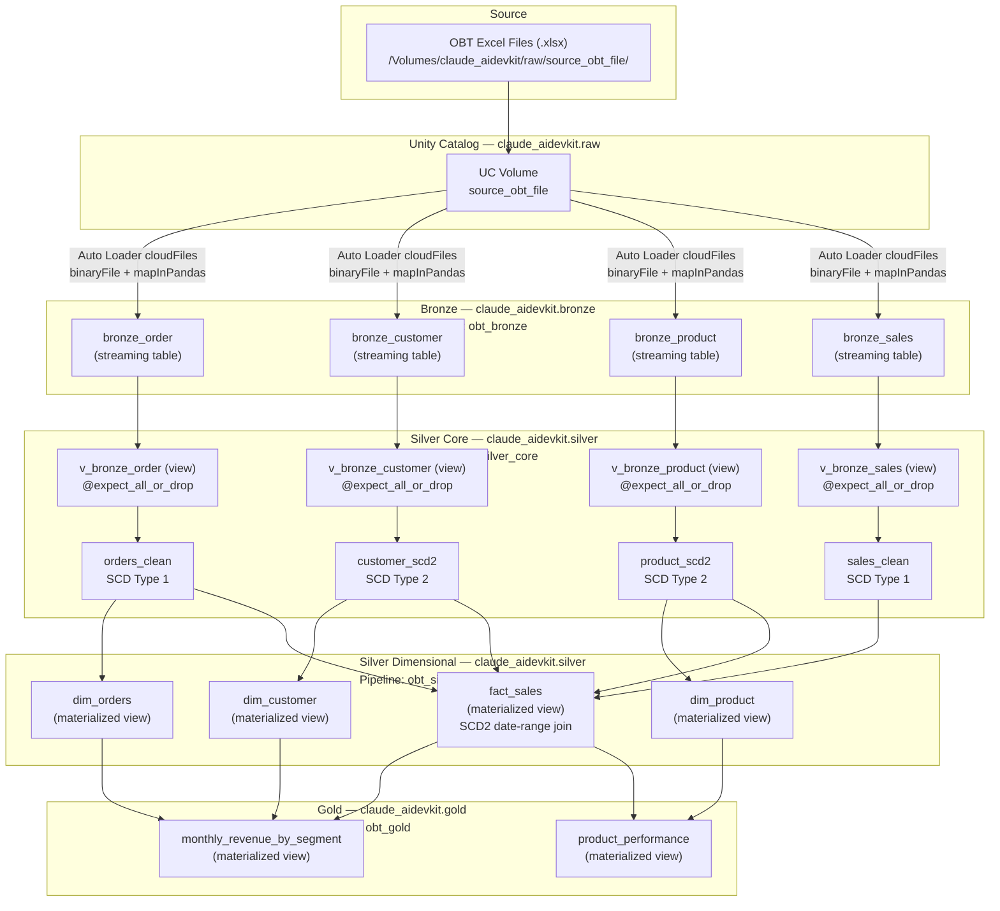
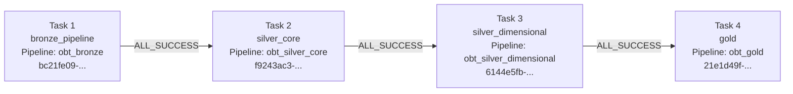

# Technical Architecture: Databricks Medallion Pipeline — `claude_aidevkit`

**Project**: OBT Excel Ingestion to Gold Analytics  
**Platform**: Databricks Lakeflow Spark Declarative Pipelines (SDP) on Unity Catalog  
**Document version**: 1.0  
**Date**: 2026-05-06  
**Author**: Anoop Kulkarni

---

## Table of Contents

1. [Executive Summary](#1-executive-summary)
2. [Architecture Overview](#2-architecture-overview)
3. [Data Flow Diagram](#3-data-flow-diagram)
4. [Source Data Profile](#4-source-data-profile)
5. [Bronze Layer](#5-bronze-layer)
6. [Silver Core Layer](#6-silver-core-layer)
7. [Silver Dimensional Layer](#7-silver-dimensional-layer)
8. [Gold Layer](#8-gold-layer)
9. [Orchestration](#9-orchestration)
10. [Data Quality Framework](#10-data-quality-framework)
11. [Design Decisions and Considerations](#11-design-decisions-and-considerations)
12. [API Reference Notes](#12-api-reference-notes)
13. [Known Limitations and Future Enhancements](#13-known-limitations-and-future-enhancements)

---

## 1. Executive Summary

This document describes the end-to-end technical architecture of a Medallion data pipeline built on Databricks Lakeflow Spark Declarative Pipelines (SDP) within the Unity Catalog `claude_aidevkit`. The pipeline ingests raw sales data delivered as OBT (One-Big-Table) Excel `.xlsx` files, progressively refines it through four governed layers — Bronze, Silver Core, Silver Dimensional, and Gold — and produces business-ready aggregations for analytical consumption.

The source data arrives as flat Excel workbooks containing a denormalised snapshot of e-commerce order, customer, product, and sales information in a single sheet. The pipeline's first responsibility is to parse these binary files reliably and split them into domain-specific streaming tables. Subsequent layers apply data quality enforcement, type standardisation, deduplication, and Slowly Changing Dimension (SCD) logic before building a star schema optimised for analytical workloads. The terminal Gold layer materialises pre-aggregated views that business consumers can query directly, without writing complex SQL.

The architecture makes deliberate choices for enterprise durability: Auto Loader provides exactly-once file ingestion with automatic checkpoint management; `apply_changes` with `stored_as_scd_type=2` preserves the full history of customer and product attribute changes so that historical analyses remain accurate over time; deterministic SHA-256 surrogate keys mean dimension lookups are reproducible and pipelines are idempotent; and a SCD2-aware date-range join in `fact_sales` ensures every sale is attributed to the correct version of a customer or product that was current at the time of purchase. The entire stack runs on serverless compute, eliminating cluster lifecycle management and reducing operational overhead to near zero. Four SDP pipelines are chained into a single Databricks Job (`claude_aidevkit_obt_bronze_to_gold`, job ID 918971891980938) that executes each stage in sequence with `ALL_SUCCESS` dependency semantics, ensuring data integrity is never compromised by a partial run.

---

## 2. Architecture Overview

### 2.1 Medallion Layer Summary

| Layer | Catalog Schema | SDP Pipeline ID | Pipeline Name | Compute Model | Primary API |
|---|---|---|---|---|---|
| Bronze | `claude_aidevkit.bronze` | `bc21fe09-ad63-4ae8-b10e-cf4c1fd146c9` | `claude_aidevkit_obt_bronze` | Serverless | `create_streaming_table` + `append_flow` |
| Silver Core | `claude_aidevkit.silver` | `f9243ac3-6e5c-4e3c-808a-0172e2e00faf` | `claude_aidevkit_obt_silver_core` | Serverless | `apply_changes` (SCD1 + SCD2) |
| Silver Dimensional | `claude_aidevkit.silver` | `6144e5fb-f2ab-4cd5-8ca3-d917ae3f673a` | `claude_aidevkit_obt_silver_dimensional` | Serverless | `@dp.materialized_view` |
| Gold | `claude_aidevkit.gold` | `21e1d49f-fbc8-4947-b4f0-8f6eed7c309c` | `claude_aidevkit_obt_gold` | Serverless | `@dp.materialized_view` |

### 2.2 Architecture Diagram



### 2.3 Unity Catalog Object Inventory

| Object Type | Three-Part Name | Purpose |
|---|---|---|
| Schema | `claude_aidevkit.raw` | Hosts the UC Volume for file landing |
| Volume | `claude_aidevkit.raw.source_obt_file` | Landing zone for `.xlsx` source files |
| Schema | `claude_aidevkit.bronze` | Raw streaming tables — one per domain |
| Schema | `claude_aidevkit.silver` | Both core (SCD) and dimensional (star schema) tables |
| Schema | `claude_aidevkit.gold` | Business-ready aggregated materialized views |
| Streaming Table | `claude_aidevkit.bronze.bronze_order` | Raw order audit trail |
| Streaming Table | `claude_aidevkit.bronze.bronze_customer` | Raw customer audit trail |
| Streaming Table | `claude_aidevkit.bronze.bronze_product` | Raw product audit trail |
| Streaming Table | `claude_aidevkit.bronze.bronze_sales` | Raw sales audit trail |
| Streaming Table | `claude_aidevkit.silver.customer_scd2` | Customer history (SCD Type 2) |
| Streaming Table | `claude_aidevkit.silver.product_scd2` | Product history (SCD Type 2) |
| Streaming Table | `claude_aidevkit.silver.orders_clean` | Deduplicated orders (SCD Type 1) |
| Streaming Table | `claude_aidevkit.silver.sales_clean` | Deduplicated sales line items (SCD Type 1) |
| Materialized View | `claude_aidevkit.silver.dim_customer` | Customer dimension with surrogate keys |
| Materialized View | `claude_aidevkit.silver.dim_product` | Product dimension with surrogate keys |
| Materialized View | `claude_aidevkit.silver.dim_orders` | Order dimension with calendar attributes |
| Materialized View | `claude_aidevkit.silver.fact_sales` | Sales fact table — SCD2-aware foreign keys |
| Materialized View | `claude_aidevkit.gold.monthly_revenue_by_segment` | Monthly revenue KPIs by segment |
| Materialized View | `claude_aidevkit.gold.product_performance` | Product-level performance metrics |

---

## 3. Data Flow Diagram

```mermaid
flowchart LR
    A["Excel .xlsx file\nlanded in UC Volume"] -->|"Auto Loader\nbinaryFile format"| B

    subgraph PARSE["Bronze Pipeline — obt_bronze"]
        B["Binary row\n(path + content bytes)"]
        B -->|"mapInPandas\nopenpyxl engine"| C["Parsed pandas DataFrame\n15 columns + 2 audit cols"]
        C -->|"append_flow\ncolumn projection"| D1["bronze_order\norder_id, order_date"]
        C -->|"append_flow\ncolumn projection"| D2["bronze_customer\ncustomer_id, name, email, segment"]
        C -->|"append_flow\ncolumn projection"| D3["bronze_product\nproduct_id, name, category, price"]
        C -->|"append_flow\ncolumn projection"| D4["bronze_sales\norder_id, product_id, measures"]
    end

    subgraph CORE["Silver Core Pipeline — obt_silver_core"]
        D2 -->|"@dp.view\ntrim + regexp_replace"| E1["v_bronze_customer\n+ expect_all_or_drop"]
        D3 -->|"@dp.view\ntrim + round + regexp_replace"| E2["v_bronze_product\n+ expect_all_or_drop"]
        D1 -->|"@dp.view\ntrim + to_date"| E3["v_bronze_order\n+ expect_all_or_drop"]
        D4 -->|"@dp.view\ntrim + round"| E4["v_bronze_sales\n+ expect_all_or_drop"]

        E1 -->|"apply_changes\nstored_as_scd_type=2\nsequence_by=_ingested_at"| F1["customer_scd2\n__START_AT, __END_AT"]
        E2 -->|"apply_changes\nstored_as_scd_type=2\nsequence_by=_ingested_at"| F2["product_scd2\n__START_AT, __END_AT"]
        E3 -->|"apply_changes\nstored_as_scd_type=1\nkeys=[order_id]"| F3["orders_clean\nlatest state"]
        E4 -->|"apply_changes\nstored_as_scd_type=1\nkeys=[order_id, product_id]"| F4["sales_clean\nlatest state"]
    end

    subgraph DIM["Silver Dimensional Pipeline — obt_silver_dimensional"]
        F1 -->|"SHA2 surrogate key\n__start_at → effective_date"| G1["dim_customer\ncustomer_sk"]
        F2 -->|"SHA2 surrogate key\n__start_at → effective_date"| G2["dim_product\nproduct_sk"]
        F3 -->|"SHA2 surrogate key\ncalendar attrs"| G3["dim_orders\norder_sk"]
        F4 -->|"INNER JOIN orders_clean"| G4
        F1 -->|"SCD2 date-range join\norder_date in [__start_at, __end_at)"| G4
        F2 -->|"SCD2 date-range join\norder_date in [__start_at, __end_at)"| G4["fact_sales\norder_sk, customer_sk, product_sk"]
    end

    subgraph GOLD_LAYER["Gold Pipeline — obt_gold"]
        G4 --> H1["monthly_revenue_by_segment\nSUM net_sales, COUNT orders\nGROUP BY year, month, segment"]
        G4 --> H2["product_performance\nSUM units_sold, AVG discount\nGROUP BY category, product"]
        G1 --> H1
        G3 --> H1
        G2 --> H2
    end
```



---

## 4. Source Data Profile

### 4.1 File Delivery

| Property | Value |
|---|---|
| File format | Microsoft Excel `.xlsx` (Office Open XML) |
| Landing location | `/Volumes/claude_aidevkit/raw/source_obt_file/` |
| Ingestion pattern | Auto Loader `cloudFiles` with `binaryFile` format — incremental, file-by-file |
| File detection | `pathGlobFilter = "*.xlsx"`, `recursiveFileLookup = true` |
| Excel parsing library | `openpyxl` via `mapInPandas` |
| Delivery model | Batch drops; new files accumulate in the Volume |
| Checkpoint management | Managed automatically by SDP per `append_flow` function |

### 4.2 Source Schema — OBT Flat Structure

The source Excel workbook uses a denormalised One-Big-Table (OBT) pattern. Every row represents a single order line item and carries full customer, product, and order context inline.

| Column Name | Raw Spark Type | Domain | Notes |
|---|---|---|---|
| `Order_ID` | `StringType` | Order | Business key for an order |
| `Order_Date` | `StringType` | Order | Stored as string in Excel; parsed to `DATE` in Silver |
| `Customer_ID` | `StringType` | Customer | Business key for a customer |
| `Customer_Name` | `StringType` | Customer | May contain special characters |
| `Customer_Email` | `StringType` | Customer | Normalised to lowercase in Silver |
| `Customer_Segment` | `StringType` | Customer | e.g. Consumer, Corporate, Home Office |
| `Product_ID` | `StringType` | Product | Business key for a product |
| `Product_Name` | `StringType` | Product | May contain parentheses, slashes |
| `Category` | `StringType` | Product | e.g. Furniture, Technology, Office Supplies |
| `Unit_Price` | `DoubleType` | Product | Price per unit at time of order |
| `Quantity` | `LongType` | Sales | Units ordered |
| `Discount` | `DoubleType` | Sales | Discount rate (0.0 – 1.0) |
| `Gross_Sales` | `DoubleType` | Sales | `Unit_Price × Quantity` |
| `Discount_Amount` | `DoubleType` | Sales | `Gross_Sales × Discount` |
| `Net_Sales` | `DoubleType` | Sales | `Gross_Sales − Discount_Amount` |

**Audit columns added at parse time:**

| Column | Type | Source |
|---|---|---|
| `_source_file` | `StringType` | `row["path"]` from Auto Loader binary row |
| `_ingested_at` | `TimestampType` | `datetime.now(timezone.utc)` at parse time |

### 4.3 Domain Decomposition Strategy

Because the source is a single flat table, the Bronze pipeline performs a logical domain split by projecting domain-relevant columns into four separate streaming tables. This decomposition:

- Allows each domain (order, customer, product, sales) to evolve its schema independently.
- Enables SCD Type 2 logic for slowly changing dimensions (customer, product) without affecting transactional entities.
- Reduces coupling between domains — a schema change in customer data does not force a re-ingest of sales data.
- Produces appropriately clustered tables (`cluster_by=["customer_id"]` on `bronze_customer`, etc.) for efficient downstream reads.

---

## 5. Bronze Layer

**Pipeline name**: `claude_aidevkit_obt_bronze`  
**Pipeline ID**: `bc21fe09-ad63-4ae8-b10e-cf4c1fd146c9`  
**Source file**: `src/pipelines/obt_bronze/pipeline.py`  
**Target schema**: `claude_aidevkit.bronze`

### 5.1 Design Philosophy

The Bronze layer is an immutable landing zone. Its sole responsibilities are:

1. Detect new `.xlsx` files arriving in the UC Volume.
2. Parse the binary Excel content into structured Spark rows.
3. Append parsed records into domain-specific streaming tables — no transformations, no filtering, no deduplication.
4. Attach source-lineage audit columns (`_source_file`, `_ingested_at`) to every row.

No data is modified, cleaned, or dropped at this layer. If a source file is malformed, parsing will fail and the pipeline will surface an error — the file will not be silently skipped. This guarantees that every record that can be parsed is preserved exactly as received.

### 5.2 Auto Loader Configuration

Auto Loader is configured with `binaryFile` format, which reads each file as a single row with a `content` column containing the raw bytes and a `path` column with the file URI:

```python
spark.readStream
    .format("cloudFiles")
    .option("cloudFiles.format", "binaryFile")
    .option("pathGlobFilter", "*.xlsx")
    .option("recursiveFileLookup", "true")
    .load("/Volumes/claude_aidevkit/raw/source_obt_file/")
```

**Why `binaryFile` instead of a structured format?** Excel `.xlsx` is a ZIP-based binary format that Spark cannot read natively as a structured stream. Reading as binary gives full control over parsing via `mapInPandas`, and means any Excel-compatible library (`openpyxl`, `xlrd`) can be used inside the pandas UDF.

**Checkpoint behaviour**: SDP manages a checkpoint per `append_flow` function. On each pipeline run, Auto Loader only processes files that have not yet been committed to the checkpoint. Files already ingested are skipped — providing exactly-once semantics without any manual offset management.

### 5.3 Excel Parsing — `mapInPandas`

The `_parse_excel` function is the critical transformation that bridges the binary world of Auto Loader and the structured world of Delta tables:

```python
def _parse_excel(batch_iter):
    import io
    from datetime import datetime, timezone
    import pandas as pd

    for batch in batch_iter:
        results = []
        for _, row in batch.iterrows():
            df = pd.read_excel(io.BytesIO(bytes(row["content"])), engine="openpyxl")
            df["_source_file"] = row["path"]
            df["_ingested_at"] = datetime.now(timezone.utc)
            # Type coercion — float columns
            for col in ("Unit_Price", "Discount", "Gross_Sales", "Discount_Amount", "Net_Sales"):
                if col in df.columns:
                    df[col] = pd.to_numeric(df[col], errors="coerce").astype("float64")
            # Type coercion — integer column
            if "Quantity" in df.columns:
                df["Quantity"] = pd.to_numeric(df["Quantity"], errors="coerce").astype("Int64")
            results.append(df[field_names])
        if results:
            yield pd.concat(results, ignore_index=True)
        else:
            yield pd.DataFrame({n: pd.Series(dtype="object") for n in field_names})
```

Key implementation details:

- **`io.BytesIO`**: wraps the raw `content` bytes so `pd.read_excel` can treat them as a file object — no disk I/O required.
- **`engine="openpyxl"`**: explicitly specifies the Excel parser. `openpyxl` is the only engine that reliably handles `.xlsx` (Office Open XML) files and is available on Databricks serverless.
- **`errors="coerce"` on numeric columns**: non-numeric values (e.g., empty cells, text) become `NaN` rather than raising an exception. This is intentional — the Silver layer's expectations will drop those rows.
- **Empty batch guard**: if a batch contains no parseable files, an empty DataFrame with the correct schema is yielded. This prevents `mapInPandas` from blocking on empty iterators.
- **`_ingested_at` set at parse time**: captures when the file was processed, not when the record was created. Used as `sequence_by` in Silver `apply_changes` to resolve late arrivals.

### 5.4 Output Schema

```python
StructType([
    StructField("Order_ID",        StringType(),    True),
    StructField("Order_Date",      StringType(),    True),  # date as string
    StructField("Customer_ID",     StringType(),    True),
    StructField("Customer_Name",   StringType(),    True),
    StructField("Customer_Email",  StringType(),    True),
    StructField("Customer_Segment",StringType(),    True),
    StructField("Product_ID",      StringType(),    True),
    StructField("Product_Name",    StringType(),    True),
    StructField("Category",        StringType(),    True),
    StructField("Unit_Price",      DoubleType(),    True),
    StructField("Quantity",        LongType(),      True),
    StructField("Discount",        DoubleType(),    True),
    StructField("Gross_Sales",     DoubleType(),    True),
    StructField("Discount_Amount", DoubleType(),    True),
    StructField("Net_Sales",       DoubleType(),    True),
    StructField("_source_file",    StringType(),    True),
    StructField("_ingested_at",    TimestampType(), True),
])
```

### 5.5 Streaming Tables and `append_flow`

Each Bronze streaming table is created with `dp.create_streaming_table(...)` and populated via an `@dp.append_flow` decorated function. `append_flow` adds a named data flow to the target streaming table — the SDP runtime registers each flow independently and tracks its checkpoint state:

```python
dp.create_streaming_table(
    "claude_aidevkit.bronze.bronze_customer",
    comment="Raw customer records — appended incrementally as new OBT files arrive",
    cluster_by=["customer_id"],
)

@dp.append_flow(target="claude_aidevkit.bronze.bronze_customer")
def ingest_bronze_customer():
    return (
        _obt_stream()
        .select(
            F.col("Customer_ID").alias("customer_id"),
            F.col("Customer_Name").alias("customer_name"),
            F.col("Customer_Email").alias("email"),
            F.col("Customer_Segment").alias("customer_segment"),
            F.col("_source_file"),
            F.col("_ingested_at"),
        )
    )
```

`_obt_stream()` is called four times — once per domain — because four independent streaming queries are required, each with their own checkpoint. Despite four calls to the same Auto Loader path, SDP assigns a separate checkpoint to each `append_flow`, so file tracking is independent per domain.

### 5.6 Bronze Table Specifications

| Table | Cluster By | Key Columns | Record Grain |
|---|---|---|---|
| `bronze_order` | `order_date` | `order_id`, `order_date` | One row per order per file ingest |
| `bronze_customer` | `customer_id` | `customer_id`, `customer_name`, `email`, `customer_segment` | One row per customer per file ingest |
| `bronze_product` | `product_id` | `product_id`, `product_name`, `category`, `unit_price` | One row per product per file ingest |
| `bronze_sales` | `order_id` | `order_id`, `product_id`, `customer_id`, financial measures | One row per order-line per file ingest |

All tables include `_source_file` and `_ingested_at` audit columns. Because Bronze uses `append_flow` (pure append, no deduplication), re-ingesting the same file will produce duplicate rows. Deduplication is the Silver Core layer's responsibility.

---

## 6. Silver Core Layer

**Pipeline name**: `claude_aidevkit_obt_silver_core`  
**Pipeline ID**: `f9243ac3-6e5c-4e3c-808a-0172e2e00faf`  
**Source file**: `src/pipelines/obt_silver/pipeline_core.py`  
**Target schema**: `claude_aidevkit.silver`

### 6.1 Design Philosophy

Silver Core is the correctness layer. Its responsibilities are:

1. Standardise data types — parse date strings, round floats, trim whitespace.
2. Remove special characters that would contaminate downstream string comparisons or cause regex/SQL injection vulnerabilities.
3. Enforce data quality expectations — drop rows that fail validation before they can corrupt the SCD merge.
4. Apply SCD logic via `dp.apply_changes` — producing idempotent, MERGE-based upserts with full history tracking for dimensions.

The result is four clean, deduplicated, strongly-typed silver tables that are the authoritative source of truth for their respective domains.

### 6.2 Source Views — Standardisation and Expectations

Each domain has a `@dp.view` that reads the corresponding Bronze streaming table, applies transformations, and validates rows via `@dp.expect_all_or_drop`. The decorator stack order matters: `@dp.expect_all_or_drop` is placed **above** `@dp.view` so that the expectation is evaluated on the output of the view function.

```python
@dp.expect_all_or_drop(_customer_scd2_expt)
@dp.view
def v_bronze_customer():
    return (
        spark.readStream
        .table("claude_aidevkit.bronze.bronze_customer")
        .select(
            F.trim(F.col("customer_id")).alias("customer_id"),
            F.regexp_replace(F.trim(F.col("customer_name")), r"[^\w\s\-\.\,]", "").alias("customer_name"),
            F.lower(F.trim(F.col("email"))).alias("email"),
            F.regexp_replace(F.trim(F.col("customer_segment")), r"[^\w\s\-\.]", "").alias("customer_segment"),
            F.col("_ingested_at"),
        )
    )
```

**Standardisation operations applied per domain:**

| Domain View | Operations |
|---|---|
| `v_bronze_customer` | `F.trim` on all string IDs; `F.regexp_replace` to strip non-alphanumeric chars from name/segment; `F.lower` on email |
| `v_bronze_product` | `F.trim` on IDs; `F.regexp_replace` on name (allows `()`, `/`) and category; `F.round(..., 2)` on `unit_price` |
| `v_bronze_order` | `F.trim` on `order_id`; `F.to_date(col, "yyyy-MM-dd")` — returns `NULL` if unparseable (caught by expectation) |
| `v_bronze_sales` | `F.trim` on all ID columns; `F.round(..., 2)` on all five monetary/percentage columns |

### 6.3 SCD Type 2 — Customer and Product Dimensions

Customers and products change over time (name corrections, price changes, segment reassignments). The pipeline uses SCD Type 2 to preserve the full history of these changes:

```python
dp.create_streaming_table(
    "claude_aidevkit.silver.customer_scd2",
    comment="SCD Type 2 customer master — full attribute history keyed on customer_id",
    cluster_by=["customer_id"],
)
dp.apply_changes(
    target="claude_aidevkit.silver.customer_scd2",
    source="v_bronze_customer",
    keys=["customer_id"],
    sequence_by=F.col("_ingested_at"),
    stored_as_scd_type=2,
    except_column_list=["_ingested_at"],
)
```

**How SCD Type 2 works in SDP:**

When `apply_changes` processes a new record for a `customer_id` that already exists with different attribute values:

1. The existing row's `__END_AT` is set to the `sequence_by` timestamp of the new record.
2. A new row is inserted with `__START_AT` = new record's `_ingested_at` and `__END_AT = NULL`.
3. `_ingested_at` is used as the sequencing field but excluded from the target table via `except_column_list` — it is a Bronze audit column, not a business attribute.

**SCD Type 2 output columns added by `apply_changes`:**

| Column | Type | Meaning |
|---|---|---|
| `__START_AT` | `TIMESTAMP` | When this version of the record became active |
| `__END_AT` | `TIMESTAMP` | When this version was superseded (`NULL` = currently active) |

**Important**: SDP's `apply_changes` with `stored_as_scd_type=2` does NOT add an `__IS_CURRENT` boolean column. The current record is identified by `__END_AT IS NULL`. Any downstream code (including `dim_customer`) must use this predicate. This was a discovered implementation learning — see Section 12.

**Late arrival handling**: Because `_ingested_at` is the `sequence_by`, a late-arriving record (a file processed out of order) will correctly insert itself into the SCD2 history. `apply_changes` re-evaluates the full sequence and inserts/closes rows as needed rather than simply appending.

### 6.4 SCD Type 1 — Orders and Sales

Orders and sales line items do not have "historical versions" in the business sense — an order either exists or it has been corrected. SCD Type 1 maintains only the latest state, merging duplicates on the business key:

```python
dp.apply_changes(
    target="claude_aidevkit.silver.orders_clean",
    source="v_bronze_order",
    keys=["order_id"],
    sequence_by=F.col("_ingested_at"),
    stored_as_scd_type=1,
    except_column_list=["_ingested_at"],
)

dp.apply_changes(
    target="claude_aidevkit.silver.sales_clean",
    source="v_bronze_sales",
    keys=["order_id", "product_id"],
    sequence_by=F.col("_ingested_at"),
    stored_as_scd_type=1,
    except_column_list=["_ingested_at"],
)
```

`sales_clean` uses a composite key of `[order_id, product_id]` because an order can contain multiple line items — one per product. The sequence `_ingested_at` ensures that if the same `(order_id, product_id)` pair appears in multiple Excel files (e.g., a correction file), only the most recent ingest wins.

### 6.5 Silver Core Table Specifications

| Table | SCD Type | Keys | `sequence_by` | Added Columns |
|---|---|---|---|---|
| `customer_scd2` | Type 2 | `customer_id` | `_ingested_at` | `__START_AT`, `__END_AT` |
| `product_scd2` | Type 2 | `product_id` | `_ingested_at` | `__START_AT`, `__END_AT` |
| `orders_clean` | Type 1 | `order_id` | `_ingested_at` | none |
| `sales_clean` | Type 1 | `order_id`, `product_id` | `_ingested_at` | none |

### 6.6 Change Data Feed (CDF)

By default, SDP-managed streaming tables have Change Data Feed (CDF) enabled on the underlying Delta table. This allows downstream pipelines to read only the changed rows using `readChangeFeed=true` without a full table scan. The Silver Dimensional pipeline benefits from this when refreshing materialized views — only changed SCD2 rows need to be re-evaluated.

---

## 7. Silver Dimensional Layer

**Pipeline name**: `claude_aidevkit_obt_silver_dimensional`  
**Pipeline ID**: `6144e5fb-f2ab-4cd5-8ca3-d917ae3f673a`  
**Source file**: `src/pipelines/obt_silver/pipeline_dimensional.py`  
**Target schema**: `claude_aidevkit.silver`

### 7.1 Design Philosophy

The Silver Dimensional layer transforms the normalised, history-preserving Silver Core tables into a star schema optimised for analytical queries. This is a clean separation of concerns:

- Silver Core owns **correctness** — every record is valid, every change is tracked.
- Silver Dimensional owns **modelling** — correct data is shaped into the form that analysts and the Gold layer can query efficiently.

This layer uses **materialized views** exclusively. Materialized views use batch semantics (`spark.read`, not `spark.readStream`), which enables SQL features that are impossible in streaming mode — most critically, the **non-equi date-range join** required to match each sale to the correct SCD2 version of a customer or product.

### 7.2 Surrogate Key Design

All dimension and fact tables use deterministic SHA-256 surrogate keys:

| Table | Surrogate Key Formula | Rationale |
|---|---|---|
| `dim_customer` | `SHA2(CONCAT(customer_id, CAST(__start_at AS STRING)), 256)` | Each SCD2 version gets a unique SK; same version always gets the same SK |
| `dim_product` | `SHA2(CONCAT(product_id, CAST(__start_at AS STRING)), 256)` | Same pattern as customer |
| `dim_orders` | `SHA2(order_id, 256)` | One row per order; only business key needed |
| `fact_sales` | Computes `customer_sk` and `product_sk` inline during the SCD2 date-range join | The SK matches the dim SK for the active version at order_date |

**Why SHA-256 over auto-increment?**

Auto-increment integers are generated at write time and are not reproducible — a full refresh of the dimension table would generate different integers, breaking all foreign key joins in the fact table. SHA-256 hashes are deterministic: the same input always produces the same 64-character hex string. This means:

- Full refresh of any dimensional table never breaks referential integrity.
- The fact table's surrogate keys remain valid across pipeline runs.
- No sequence/identity column management is required.
- The 256-bit hash space makes collisions effectively impossible for this data volume.

### 7.3 Dimension Tables

#### `dim_customer`

```sql
SELECT
    SHA2(CONCAT(customer_id, CAST(__start_at AS STRING)), 256) AS customer_sk,
    customer_id,
    customer_name,
    email,
    customer_segment,
    CAST(__start_at AS DATE)   AS effective_date,
    CAST(__end_at   AS DATE)   AS expiry_date,
    (__end_at IS NULL)         AS is_current
FROM claude_aidevkit.silver.customer_scd2
```

- Includes **all SCD2 versions** (current and historical).
- `is_current` is a derived boolean: `TRUE` when `__end_at IS NULL`.
- `effective_date` and `expiry_date` are cast from `TIMESTAMP` to `DATE` for use in date-range joins.
- Upstream `@dp.expect_all_or_drop` validates that `customer_sk`, `customer_id`, and `effective_date` are non-null.

#### `dim_product`

```sql
SELECT
    SHA2(CONCAT(product_id, CAST(__start_at AS STRING)), 256) AS product_sk,
    product_id,
    product_name,
    category,
    unit_price,
    CAST(__start_at AS DATE)   AS effective_date,
    CAST(__end_at   AS DATE)   AS expiry_date,
    (__end_at IS NULL)         AS is_current
FROM claude_aidevkit.silver.product_scd2
```

- Same structural pattern as `dim_customer`.
- `unit_price` reflects the listed price for that particular historical version — essential for correct historical revenue analysis.

#### `dim_orders`

```sql
SELECT
    SHA2(order_id, 256)    AS order_sk,
    order_id,
    order_date,
    YEAR(order_date)       AS order_year,
    QUARTER(order_date)    AS order_quarter,
    MONTH(order_date)      AS order_month
FROM claude_aidevkit.silver.orders_clean
```

- One row per order — no SCD history needed (orders do not change).
- Pre-computes calendar attributes (`order_year`, `order_quarter`, `order_month`) to avoid repeated `YEAR()`/`MONTH()` calls in Gold layer queries.
- `order_sk = SHA2(order_id, 256)` — consistent with the `order_sk` computed in `fact_sales`.

### 7.4 Fact Table — `fact_sales`

`fact_sales` is the most complex object in the pipeline. It joins three sources using a combination of equi-joins and non-equi date-range joins:

```sql
SELECT
    sc.order_id,
    o.order_date,
    SHA2(sc.order_id, 256)                                               AS order_sk,
    SHA2(CONCAT(sc.customer_id, CAST(dc.__start_at AS STRING)), 256)     AS customer_sk,
    SHA2(CONCAT(sc.product_id,  CAST(dp.__start_at AS STRING)), 256)     AS product_sk,
    sc.quantity,
    sc.discount,
    sc.gross_sales,
    sc.discount_amount,
    sc.net_sales
FROM claude_aidevkit.silver.sales_clean sc
INNER JOIN claude_aidevkit.silver.orders_clean o
    ON sc.order_id = o.order_id
LEFT JOIN claude_aidevkit.silver.customer_scd2 dc
    ON  sc.customer_id = dc.customer_id
    AND o.order_date >= CAST(dc.__start_at AS DATE)
    AND (dc.__end_at IS NULL OR o.order_date < CAST(dc.__end_at AS DATE))
LEFT JOIN claude_aidevkit.silver.product_scd2 dp
    ON  sc.product_id = dp.product_id
    AND o.order_date >= CAST(dp.__start_at AS DATE)
    AND (dp.__end_at IS NULL OR o.order_date < CAST(dp.__end_at AS DATE))
```

**The SCD2 date-range join — explained:**

For every sales line item, the join finds the SCD2 row for customer and product whose validity interval `[__start_at, __end_at)` contains the `order_date`:

```
order_date >= CAST(__start_at AS DATE)      -- order happened after or on start of this version
AND (
    __end_at IS NULL                         -- version is still current
    OR order_date < CAST(__end_at AS DATE)  -- order happened before this version was superseded
)
```

This ensures that if a customer changed their segment from "Consumer" to "Corporate" on 2025-06-01, orders placed before that date are attributed to the "Consumer" segment, and orders after are attributed to "Corporate". Historical reporting is accurate.

**Why `LEFT JOIN` not `INNER JOIN` for SCD2 tables?**

If a customer or product was deleted from source systems before any SCD2 record was captured, or if there is a gap in the SCD2 history, an `INNER JOIN` would silently drop the fact row. A `LEFT JOIN` preserves all sales — the resulting `customer_sk` or `product_sk` will be `NULL`, which is caught by `@dp.expect_all_or_drop` expectations on `fact_sales` if this is considered a blocking quality issue.

**Surrogate key consistency:**

The `customer_sk` in `fact_sales` is computed using the same formula as in `dim_customer`:

```python
# fact_sales:
SHA2(CONCAT(sc.customer_id, CAST(dc.__start_at AS STRING)), 256)  AS customer_sk

# dim_customer:
SHA2(CONCAT(customer_id, CAST(__start_at AS STRING)), 256)  AS customer_sk
```

Because `dc.__start_at` in `fact_sales` is the same `__start_at` that appears in `dim_customer` for the matched SCD2 row, the two surrogate keys are always identical. Joins from `fact_sales` to `dim_customer` on `customer_sk` are guaranteed to match.

### 7.5 Decorator Stack Order for Materialized Views

In SDP, when stacking `@dp.materialized_view` and `@dp.expect_all_or_drop`, the materialized view decorator must be the outermost (topmost):

```python
@dp.materialized_view(name="claude_aidevkit.silver.dim_customer")
@dp.expect_all_or_drop(_dim_customer_expt)
def dim_customer():
    ...
```

`@dp.materialized_view` wraps the function first, producing a MV definition. `@dp.expect_all_or_drop` then attaches expectations to that MV definition. Reversing the order would attach expectations before the MV is defined, which is not supported.

### 7.6 Star Schema

```
                    ┌─────────────────────┐
                    │     dim_orders      │
                    │  order_sk (PK)      │
                    │  order_id           │
                    │  order_date         │
                    │  order_year         │
                    │  order_quarter      │
                    │  order_month        │
                    └──────────┬──────────┘
                               │ order_sk
                               │
┌─────────────────┐            │          ┌──────────────────────┐
│  dim_customer   │            │          │    dim_product        │
│  customer_sk(PK)│            │          │  product_sk (PK)      │
│  customer_id    │            │          │  product_id           │
│  customer_name  │            │          │  product_name         │
│  email          ├────────────┤          │  category             │
│  customer_segment│           │          │  unit_price           │
│  effective_date │            │          │  effective_date       │
│  expiry_date    │            │          │  expiry_date          │
│  is_current     │            │          │  is_current           │
└─────────────────┘            │          └──────────────────────┘
         │ customer_sk          │                    │ product_sk
         │                ┌────┴──────────────┐      │
         └────────────────┤    fact_sales     ├──────┘
                          │  order_id         │
                          │  order_date       │
                          │  order_sk  (FK)   │
                          │  customer_sk (FK) │
                          │  product_sk  (FK) │
                          │  quantity         │
                          │  discount         │
                          │  gross_sales      │
                          │  discount_amount  │
                          │  net_sales        │
                          └───────────────────┘
```

---

## 8. Gold Layer

**Pipeline name**: `claude_aidevkit_obt_gold`  
**Pipeline ID**: `21e1d49f-fbc8-4947-b4f0-8f6eed7c309c`  
**Source file**: `src/pipelines/obt_gold/pipeline.py`  
**Target schema**: `claude_aidevkit.gold`

### 8.1 Design Philosophy

The Gold layer is the business consumption layer. It reads exclusively from the Silver Dimensional star schema and produces pre-aggregated, business-labelled materialized views. Gold tables are designed to be queried directly by:

- Databricks SQL dashboards and BI tools.
- Databricks Genie Spaces for natural language analytics.
- Databricks AI Functions for enrichment (e.g., `ai_classify` on product categories).
- Direct SQL via the Unity Catalog.

Because all SCD2 complexity was resolved in `fact_sales`, Gold queries are simple `GROUP BY` aggregations. No date-range joins or history-awareness is required — joining `fact_sales.customer_sk → dim_customer.customer_sk` automatically delivers the historically correct customer version.

### 8.2 `monthly_revenue_by_segment`

```python
@dp.materialized_view(name="claude_aidevkit.gold.monthly_revenue_by_segment")
def monthly_revenue_by_segment():
    return spark.sql("""
        SELECT
            d.order_year,
            d.order_month,
            c.customer_segment,
            COUNT(DISTINCT f.order_id)           AS total_orders,
            COUNT(DISTINCT f.customer_sk)        AS unique_customers,
            SUM(f.quantity)                      AS total_units_sold,
            ROUND(SUM(f.gross_sales),     2)     AS gross_revenue,
            ROUND(SUM(f.discount_amount), 2)     AS total_discounts,
            ROUND(SUM(f.net_sales),       2)     AS net_revenue,
            ROUND(
                SUM(f.discount_amount) / NULLIF(SUM(f.gross_sales), 0) * 100,
            2)                                   AS discount_rate_pct
        FROM claude_aidevkit.silver.fact_sales f
        JOIN claude_aidevkit.silver.dim_orders d    ON f.order_sk   = d.order_sk
        JOIN claude_aidevkit.silver.dim_customer c  ON f.customer_sk = c.customer_sk
        GROUP BY d.order_year, d.order_month, c.customer_segment
        ORDER BY d.order_year, d.order_month, c.customer_segment
    """)
```

**Business metrics produced:**

| Metric | Formula | Business Use |
|---|---|---|
| `total_orders` | `COUNT(DISTINCT order_id)` | Order volume KPI |
| `unique_customers` | `COUNT(DISTINCT customer_sk)` | Customer reach (SCD2-aware: counts unique version instances) |
| `total_units_sold` | `SUM(quantity)` | Volume KPI |
| `gross_revenue` | `SUM(gross_sales)` | Pre-discount revenue |
| `total_discounts` | `SUM(discount_amount)` | Discount cost |
| `net_revenue` | `SUM(net_sales)` | Actual recognised revenue |
| `discount_rate_pct` | `total_discounts / gross_revenue × 100` | Discount effectiveness; `NULLIF` prevents division by zero |

**Grain**: one row per `(order_year, order_month, customer_segment)`.

**SCD2 awareness**: The `JOIN fact_sales f ON f.customer_sk = c.customer_sk` join means the `customer_segment` label on each sale is the segment that customer belonged to **at the time of purchase**. If a customer moved from "Consumer" to "Corporate", their historical orders are attributed to "Consumer" and future orders to "Corporate" — a level of accuracy that a simple current-state join cannot provide.

### 8.3 `product_performance`

```python
@dp.materialized_view(name="claude_aidevkit.gold.product_performance")
def product_performance():
    return spark.sql("""
        SELECT
            p.category,
            p.product_id,
            p.product_name,
            ROUND(p.unit_price, 2)               AS listed_unit_price,
            COUNT(DISTINCT f.order_id)           AS total_orders,
            SUM(f.quantity)                      AS units_sold,
            ROUND(SUM(f.gross_sales),     2)     AS gross_revenue,
            ROUND(SUM(f.discount_amount), 2)     AS total_discounts,
            ROUND(SUM(f.net_sales),       2)     AS net_revenue,
            ROUND(AVG(f.discount),        2)     AS avg_discount_rate,
            ROUND(
                SUM(f.net_sales) / NULLIF(SUM(f.quantity), 0),
            2)                                   AS avg_net_revenue_per_unit
        FROM claude_aidevkit.silver.fact_sales f
        JOIN claude_aidevkit.silver.dim_product p ON f.product_sk = p.product_sk
        GROUP BY p.category, p.product_id, p.product_name, p.unit_price
        ORDER BY p.category, net_revenue DESC
    """)
```

**Business metrics produced:**

| Metric | Formula | Business Use |
|---|---|---|
| `total_orders` | `COUNT(DISTINCT order_id)` | Product popularity by order count |
| `units_sold` | `SUM(quantity)` | Total units moved |
| `gross_revenue` | `SUM(gross_sales)` | Pre-discount revenue contribution |
| `total_discounts` | `SUM(discount_amount)` | Total value discounted |
| `net_revenue` | `SUM(net_sales)` | Actual revenue contribution |
| `avg_discount_rate` | `AVG(discount)` | Average discount applied per line item |
| `avg_net_revenue_per_unit` | `SUM(net_sales) / SUM(quantity)` | Effective price realised per unit; `NULLIF` prevents division by zero |

**Grain**: one row per `(category, product_id, product_name, unit_price)`. Including `unit_price` in the GROUP BY means that if a product's price changed (an SCD2 event), its historical sales at the old price and new price are reported as separate rows — preserving pricing accuracy.

**SCD2 awareness**: The `JOIN fact_sales f ON f.product_sk = p.product_sk` join delivers the product attributes (name, category, `unit_price`) that were in effect at the time of the sale. Products that were renamed or recategorised are reported under their historical labels for historical orders.

---

## 9. Orchestration

### 9.1 Databricks Job

| Property | Value |
|---|---|
| Job name | `claude_aidevkit_obt_bronze_to_gold` |
| Job ID | `918971891980938` |
| Compute | Serverless (inherited from pipeline configurations) |
| Trigger | Manual / scheduled (configurable) |
| `full_refresh` | `false` on all tasks (incremental by default) |

### 9.2 Job DAG



### 9.3 Task Dependency Logic

All four tasks use `ALL_SUCCESS` dependency:

- If `bronze_pipeline` fails (e.g., a malformed `.xlsx` file causes parsing to error), `silver_core` does not run. This prevents Silver from attempting to read Bronze tables that may be in an inconsistent state.
- If `silver_core` fails (e.g., `apply_changes` encounters a schema incompatibility), `silver_dimensional` does not run. This prevents the dimensional layer from reading incomplete SCD2 data.
- If `silver_dimensional` fails, `gold` does not run. This prevents Gold from aggregating stale or incomplete dimensional data.

### 9.4 Incremental Execution

`full_refresh: false` on all tasks means:

- **Bronze**: Auto Loader only processes new files (checkpoint state is maintained between runs).
- **Silver Core**: `apply_changes` only processes new changes from Bronze via Change Data Feed.
- **Silver Dimensional**: Materialized views compute only the delta since the last run (SDP-managed incremental refresh).
- **Gold**: Materialized views refresh incrementally based on changes in the Silver Dimensional layer.

A full refresh can be triggered per-task when needed (e.g., after a schema change), without requiring the entire pipeline to be re-run from scratch.

### 9.5 Failure Recovery

| Failure Scenario | Automatic Recovery | Manual Intervention |
|---|---|---|
| New `.xlsx` file with parsing error | Pipeline fails; other files already ingested are committed | Fix the file; re-run the job |
| Network issue during Auto Loader scan | SDP retries via its internal retry policy | None needed |
| Silver Core schema mismatch | Pipeline fails; no partial write to silver | Resolve schema conflict; run silver_core only |
| Silver Dimensional full refresh needed | Trigger `full_refresh: true` on `silver_dimensional` task only | Admin action |
| Gold aggregation SQL error | Pipeline fails; Silver layer is unaffected | Fix the SQL; re-run gold task |

---

## 10. Data Quality Framework

### 10.1 Framework Overview

Data quality is enforced via SDP's built-in `@dp.expect_all_or_drop` decorator, which accepts a dictionary of named SQL boolean expressions. Every row that fails any expectation is silently dropped from the dataset — it does not reach the downstream `apply_changes` or materialized view.

The framework operates at two layers:

1. **Silver Core**: expectations on `v_bronze_*` source views — validates and cleans raw Bronze data before SCD merge.
2. **Silver Dimensional**: expectations on materialized views — validates that surrogate keys and foreign keys are non-null after the join logic.

### 10.2 Expectation Inventory

#### Silver Core — Source View Expectations

**`v_bronze_customer` — `_customer_scd2_expt`:**

| Rule Name | SQL Expression | Purpose |
|---|---|---|
| `customer_scd2__valid_customer_id` | `customer_id IS NOT NULL` | Reject rows with no business key |
| `customer_scd2__no_special_chars_name` | `customer_name NOT RLIKE '[^a-zA-Z0-9 _.,-]'` | Allow only safe name characters |
| `customer_scd2__no_special_chars_email` | `email NOT RLIKE '[^a-zA-Z0-9@.+_-]'` | Allow only email-safe characters |
| `customer_scd2__no_special_chars_segment` | `customer_segment NOT RLIKE '[^a-zA-Z0-9 _.-]'` | Allow only safe segment characters |

**`v_bronze_product` — `_product_scd2_expt`:**

| Rule Name | SQL Expression | Purpose |
|---|---|---|
| `product_scd2__valid_product_id` | `product_id IS NOT NULL` | Reject rows with no business key |
| `product_scd2__no_special_chars_name` | `product_name NOT RLIKE '[^a-zA-Z0-9 _.,()/-]'` | Allow parentheses, slashes common in product names |
| `product_scd2__no_special_chars_category` | `category NOT RLIKE '[^a-zA-Z0-9 _.-]'` | Allow only safe category characters |
| `product_scd2__non_negative_unit_price` | `unit_price >= 0` | Reject negative prices |

**`v_bronze_order` — `_orders_clean_expt`:**

| Rule Name | SQL Expression | Purpose |
|---|---|---|
| `orders_clean__valid_order_id` | `order_id IS NOT NULL` | Reject rows with no business key |
| `orders_clean__valid_order_date` | `order_date IS NOT NULL` | Reject dates that `F.to_date` could not parse |

**`v_bronze_sales` — `_sales_clean_expt`:**

| Rule Name | SQL Expression | Purpose |
|---|---|---|
| `sales_clean__valid_order_id` | `order_id IS NOT NULL` | Referential integrity |
| `sales_clean__valid_product_id` | `product_id IS NOT NULL` | Referential integrity |
| `sales_clean__valid_customer_id` | `customer_id IS NOT NULL` | Referential integrity |
| `sales_clean__non_negative_quantity` | `quantity >= 0` | Reject negative units |
| `sales_clean__non_negative_discount` | `discount >= 0` | Reject negative discount rates |
| `sales_clean__non_negative_gross_sales` | `gross_sales >= 0` | Reject negative gross revenue |
| `sales_clean__non_negative_discount_amount` | `discount_amount >= 0` | Reject negative discounts |
| `sales_clean__non_negative_net_sales` | `net_sales >= 0` | Reject negative net revenue |

#### Silver Dimensional — Materialized View Expectations

**`dim_customer` — `_dim_customer_expt`:**

| Rule Name | SQL Expression | Purpose |
|---|---|---|
| `dim_customer__valid_customer_sk` | `customer_sk IS NOT NULL` | Surrogate key must be resolvable |
| `dim_customer__valid_customer_id` | `customer_id IS NOT NULL` | Business key must be present |
| `dim_customer__valid_effective_date` | `effective_date IS NOT NULL` | SCD2 validity interval must have a start |

**`dim_product` — `_dim_product_expt`:**

| Rule Name | SQL Expression | Purpose |
|---|---|---|
| `dim_product__valid_product_sk` | `product_sk IS NOT NULL` | Surrogate key must be resolvable |
| `dim_product__valid_product_id` | `product_id IS NOT NULL` | Business key must be present |
| `dim_product__valid_effective_date` | `effective_date IS NOT NULL` | SCD2 validity interval must have a start |
| `dim_product__non_negative_unit_price` | `unit_price >= 0` | Price integrity in dimension |

**`dim_orders` — `_dim_orders_expt`:**

| Rule Name | SQL Expression | Purpose |
|---|---|---|
| `dim_orders__valid_order_sk` | `order_sk IS NOT NULL` | Surrogate key must be resolvable |
| `dim_orders__valid_order_id` | `order_id IS NOT NULL` | Business key must be present |
| `dim_orders__valid_order_date` | `order_date IS NOT NULL` | Order date must be valid |

**`fact_sales` — `_fact_sales_expt`:**

| Rule Name | SQL Expression | Purpose |
|---|---|---|
| `fact_sales__valid_order_id` | `order_id IS NOT NULL` | Grain key |
| `fact_sales__valid_order_sk` | `order_sk IS NOT NULL` | FK to dim_orders |
| `fact_sales__valid_customer_sk` | `customer_sk IS NOT NULL` | FK to dim_customer; NULL = SCD2 join failed |
| `fact_sales__valid_product_sk` | `product_sk IS NOT NULL` | FK to dim_product; NULL = SCD2 join failed |
| `fact_sales__non_negative_quantity` | `quantity >= 0` | Measure integrity |
| `fact_sales__non_negative_discount` | `discount >= 0` | Measure integrity |
| `fact_sales__non_negative_gross_sales` | `gross_sales >= 0` | Measure integrity |
| `fact_sales__non_negative_discount_amount` | `discount_amount >= 0` | Measure integrity |
| `fact_sales__non_negative_net_sales` | `net_sales >= 0` | Measure integrity |

### 10.3 Violation Handling

`@dp.expect_all_or_drop` silently drops rows that fail any expectation and increments SDP's internal metrics counters. Dropped rows are visible in the pipeline's event log and the `event_log` system table. The pipeline itself does not fail on dropped rows — it continues processing valid rows.

Alternatives considered:

| Strategy | Decorator | Behaviour | When to Use |
|---|---|---|---|
| Drop bad rows | `@dp.expect_all_or_drop` | Row is silently removed | When bad data must not contaminate downstream |
| Warn but keep | `@dp.expect_or_fail` | Pipeline fails on any violation | When data quality is a hard contract |
| Quarantine | `@dp.expect_all` + manual routing | Row is kept, violation is flagged | When bad rows need investigation |

This pipeline uses `expect_all_or_drop` throughout because:
- Contaminated rows in SCD2 tables would corrupt all downstream history.
- Business stakeholders have agreed that rows failing basic structural checks (null keys, negative prices) are erroneous and should not be processed.

### 10.4 Regex Character Class Design

The pipeline uses explicit character class whitelists (e.g., `[^a-zA-Z0-9 _.-]`) rather than Perl-style shorthand classes (e.g., `[^\w\s]`). This was a discovered implementation requirement.

The problem with `[^\w\s]` in SQL expectation strings:

1. In Python source, the string `"[^\\w\\s]"` represents the literal text `[^\w\s]`.
2. When passed to Spark SQL's string literal parser, `\w` and `\s` are interpreted as escape sequences and stripped, producing `[^ws]` — a character class that only rejects `w` and `s`, not special characters.

The solution is to spell out the allowed characters explicitly:

```python
# WRONG — regex is silently corrupted
"customer_name NOT RLIKE '[^\\w\\s\\-\\.]'"

# CORRECT — explicit character class, hyphen at end to avoid range interpretation
"customer_name NOT RLIKE '[^a-zA-Z0-9 _.,-]'"
```

The hyphen (`-`) must be placed at the **end** of the character class to be treated as a literal hyphen. Placing it between two characters (e.g., `[a-z-A-Z]`) would create a range expression between `z` and `A`, which is undefined behaviour.

---

## 11. Design Decisions and Considerations

### 11.1 Why Medallion Architecture Over a Single Pipeline?

**Decision**: Implement four separate layers (Bronze, Silver Core, Silver Dimensional, Gold) rather than a single end-to-end transformation pipeline.

**Rationale**:

- **Separation of concerns**: Each layer has a single, well-defined responsibility. Bronze owns raw ingestion; Silver Core owns correctness; Silver Dimensional owns modelling; Gold owns aggregation. Changes to one layer do not cascade to others unless intentional.
- **Incremental processing**: Each layer processes only the delta since its last run. Without layering, a single pipeline would need to re-process all source data on every run to ensure correctness.
- **Fault isolation**: A failure in Silver Dimensional (e.g., a SQL error in `fact_sales`) does not affect Bronze or Silver Core. The clean, validated Silver Core data is preserved and can be re-run once the dimensional logic is fixed.
- **Data archaeology**: Because Bronze preserves raw records with `_source_file` audit columns, it is always possible to re-run downstream layers from scratch against the original data. This is invaluable during schema evolution or when a bug is discovered in a transformation.
- **Access control**: Unity Catalog grants can be applied at the schema level. Data engineers get write access to Bronze; data modellers to Silver; data analysts get read access to Gold. This enforces least-privilege principles.

**Trade-offs**:

- Four pipelines to maintain instead of one.
- Increased end-to-end latency (each layer must complete before the next begins).
- Additional storage cost for intermediate tables.

### 11.2 Why Spark Declarative Pipelines Over Traditional PySpark Jobs?

**Decision**: Use SDP (`pyspark.pipelines`) rather than plain PySpark Spark Structured Streaming or batch jobs.

**Rationale**:

- **Automatic dependency management**: SDP infers the execution order of tables and views from the `source` references in `apply_changes` and the table names in `spark.readStream.table(...)`. No manual DAG construction is required.
- **Built-in `apply_changes`**: Implementing SCD Type 2 manually in PySpark requires complex MERGE logic, sequence handling, and NULL handling for `__END_AT`. `apply_changes` encapsulates all of this correctly.
- **Auto Loader integration**: SDP natively manages Auto Loader checkpoints per flow, preventing data loss and duplicate processing without any manual offset management.
- **Declarative expectations**: `@dp.expect_all_or_drop` integrates quality enforcement directly into the pipeline definition. In a raw Spark job, this would require manual `filter()` calls and separate metrics tracking.
- **Unity Catalog native**: SDP tables are automatically registered in Unity Catalog with lineage tracking, data classification, and access control.
- **Serverless compute**: SDP pipelines run on serverless compute without any cluster configuration.

**Trade-offs**:

- SDP is a higher-level abstraction with fewer escape hatches for highly custom logic.
- The `pyspark.pipelines` API differs from the `dlt` API (Delta Live Tables legacy) — not all `dlt` documentation applies directly.
- Debugging failed pipelines requires understanding SDP's event log rather than standard Spark UI.

### 11.3 Why SCD Type 2 for Customer and Product, but SCD Type 1 for Orders and Sales?

**Decision**: Apply `stored_as_scd_type=2` to `customer_scd2` and `product_scd2`; apply `stored_as_scd_type=1` to `orders_clean` and `sales_clean`.

**Rationale**:

SCD Type 2 is appropriate when:
- The entity's attributes change over time.
- Historical analysis must reflect what the attribute value *was* at a point in time, not what it *is* today.
- **Customer**: Customer segments, email addresses, and names change. A customer moving from "Consumer" to "Corporate" should not retroactively reclassify their past orders.
- **Product**: Product names get corrected, categories get reorganised, prices change. Historical revenue analysis by category must use the category that was in effect at sale time.

SCD Type 1 is appropriate when:
- The entity represents a transaction or event — it happened, it does not "change".
- The latest correction is the canonical truth.
- **Order**: An order is a business event. If `Order_Date` was incorrectly recorded and corrected in a later file, the corrected date is the truth. There is no business need for "the order date we used to have".
- **Sales**: A sales line item is a financial record. Corrections (e.g., quantity updated) should overwrite the erroneous value, not preserve it as history.

**Trade-offs of SCD2**:
- More storage — multiple rows per customer/product.
- More complex joins — the date-range join in `fact_sales` adds query complexity.
- Rebuilding SCD2 history from scratch is expensive if the Bronze source changes.

**Trade-offs of SCD1**:
- History is lost — impossible to know what an order's date was before a correction.
- Simpler storage and joins.

### 11.4 Why Separate Silver Core and Silver Dimensional Pipelines?

**Decision**: Split Silver into two separate pipelines (`obt_silver_core` and `obt_silver_dimensional`) rather than a single Silver pipeline.

**Rationale**:

- **API incompatibility**: Silver Core uses `apply_changes` which requires `create_streaming_table` targets (streaming semantics). Silver Dimensional uses `@dp.materialized_view` (batch semantics). Within a single SDP pipeline file, mixing streaming and batch contexts is possible but creates coupling that makes maintenance harder.
- **Refresh cadence**: Silver Core should run every time new Bronze data arrives. Silver Dimensional only needs to run after Silver Core completes. Separating them allows the orchestration job to enforce this sequencing explicitly via `ALL_SUCCESS` dependencies.
- **Independent failure recovery**: If a SQL error in `fact_sales` breaks the dimensional pipeline, the core SCD tables are unaffected and do not need to be re-processed.
- **Schema evolution**: When adding a new column to `dim_customer`, only the dimensional pipeline needs to be updated and full-refreshed. Silver Core continues running without interruption.
- **Unit testability**: Each pipeline can be tested independently with mocked inputs.

**Trade-offs**:
- Two pipelines to manage instead of one.
- Slightly more complex job DAG (four tasks instead of three).

### 11.5 Why Materialized Views for the Dimensional Layer?

**Decision**: Use `@dp.materialized_view` (batch semantics) for Silver Dimensional and Gold, rather than streaming tables.

**Rationale**:

- **Non-equi join support**: The SCD2 date-range join in `fact_sales` (`order_date >= __start_at AND order_date < __end_at`) is a non-equi join. Spark Structured Streaming does not support non-equi stream-stream joins. This is a hard requirement that mandates batch semantics.
- **Full-scan correctness**: Materialized views perform a conceptually complete recomputation of the result. For `fact_sales`, every sale must be evaluated against the current full SCD2 history to find the correct historical version. Streaming MERGE cannot guarantee this without complex watermarking.
- **Simpler SQL**: Batch SQL aggregations in Gold are straightforward. Streaming aggregations with watermarks and late data handling add unnecessary complexity for a Gold layer that only needs to be current after each pipeline run.
- **Auto incremental refresh**: SDP automatically determines which partitions of a materialized view need refreshing based on upstream changes, without requiring manual partitioning logic.

**Trade-offs**:
- Higher latency than streaming — results are available after the batch refresh completes, not continuously.
- Materialized views may trigger a full refresh when upstream schema changes, which can be expensive for large tables.

### 11.6 Why Deterministic SHA-256 Surrogate Keys?

**Decision**: Use `SHA2(CONCAT(business_key, CAST(__start_at AS STRING)), 256)` as the surrogate key rather than auto-increment integers or UUIDs.

**Rationale**:

- **Idempotency**: Running the dimensional pipeline twice produces exactly the same surrogate keys. This is critical for materialized views that may be fully refreshed.
- **No sequence management**: Auto-increment requires a persistent sequence or identity column. SDP materialized views do not support sequences because they are computed from SQL; there is no guaranteed single-pass execution order.
- **Cross-table consistency**: `fact_sales` computes `customer_sk` using the same formula as `dim_customer`. The two hashes are equal by construction, requiring no lookup table or join-time key resolution.
- **Collision safety**: SHA-256 produces a 256-bit hash. The probability of a collision in any realistic e-commerce dataset is astronomically small (effectively zero).
- **UUID alternative rejected**: UUIDs (`uuid()`) are non-deterministic — each call produces a different value. Full refresh of `dim_customer` would produce different UUIDs than the previous run, breaking all foreign key joins in `fact_sales`.

**Trade-offs**:
- 64-character hex string keys consume more storage than 8-byte integers.
- SHA2 computation adds a small CPU cost per row.
- Less human-readable than sequential integers in debugging scenarios.

### 11.7 Why Serverless Compute?

**Decision**: Run all four SDP pipelines on serverless compute rather than provisioned clusters.

**Rationale**:

- **Zero cluster management**: No cluster size selection, autoscaling configuration, or spot instance management. Databricks manages all infrastructure automatically.
- **Cost efficiency**: Serverless compute bills per DBU consumed, not per cluster-hour. For pipelines that run infrequently (e.g., once daily), serverless is significantly cheaper than keeping a cluster on standby.
- **Instant startup**: Serverless pipelines start immediately without cluster provisioning delay (typically 30-120 seconds for provisioned clusters).
- **SDP native**: SDP pipelines are designed to run on serverless compute. All SDP features (including `apply_changes` and Auto Loader) are fully supported on serverless.
- **Automatic scaling**: Serverless compute scales resources up and down within a run based on the workload, without manual configuration.

**Trade-offs**:
- Less control over the underlying Spark configuration (cannot set custom Spark configs).
- Networking restrictions — serverless compute cannot access private endpoints without Databricks Private Connectivity.
- Per-DBU cost may be higher than provisioned clusters for very long-running or large-scale pipelines.

### 11.8 Why `apply_changes` Over `append_flow` for Silver Core?

**Decision**: Use `dp.apply_changes(...)` for all four Silver Core tables rather than `@dp.append_flow`.

**Rationale**:

- **Idempotency**: `apply_changes` uses MERGE semantics. If the same record is processed twice (e.g., the same file is dropped into the Volume again), the MERGE operation is idempotent — it does not create duplicate rows.
- **Late arrival handling**: When a record arrives out of order, `apply_changes` re-evaluates the sequence and correctly inserts/closes SCD2 rows. `append_flow` would create duplicate rows for late arrivals.
- **Deduplication**: The Bronze layer uses `append_flow`, which means Bronze tables can contain duplicate records (same `order_id` in two Excel files). `apply_changes` with `keys=[order_id]` automatically deduplicates during MERGE.
- **SCD Type 2**: `apply_changes` is the only SDP API that produces SCD Type 2 history. `append_flow` has no concept of historical versions.

**Trade-offs**:
- `apply_changes` is more expensive than `append_flow` — it requires a MERGE rather than a simple append.
- Requires a separate `create_streaming_table` call before `apply_changes`.
- More complex error handling — MERGE failures can leave the target table in a partially updated state.

### 11.9 Why Inline Expectations Over Separate Config Files?

**Decision**: Inline all expectation dictionaries directly in `pipeline_core.py` and `pipeline_dimensional.py` rather than importing them from the `config/exceptions/` module.

**Rationale — a hard technical constraint:**

Databricks workspace notebooks — even those created from `.py` files using `databricks workspace import --language PYTHON` — are stored as notebook objects in the workspace, not as raw Python files on the driver filesystem. When SDP runs a pipeline, it executes the pipeline file in a restricted environment where Python's `import` mechanism cannot locate workspace notebooks as modules.

Attempting to `from config.exceptions.customer_scd2_expt import customer_scd2_expt` raises `NotebookImportException` because the file cannot be found on `sys.path`.

The `config/exceptions/` directory serves as the **development-time source of truth** for local IDE development and testing. When deploying to Databricks, the expectation dictionaries are copied inline into the pipeline files. This is not a design preference — it is a constraint of the deployment model.

A future solution would be to deploy the `config/` directory as a Python wheel or to use Databricks Repos (which do expose raw `.py` files). See Section 13.

**Trade-offs**:
- Expectation logic is duplicated between `config/exceptions/` (local dev) and the pipeline files (Databricks).
- Changes to expectations must be applied in two places.
- No automated synchronisation mechanism currently exists.

### 11.10 SCD2 Date-Range Join vs Current-Version Join in `fact_sales`

**Decision**: Use the full SCD2 date-range join in `fact_sales` rather than a simpler join to the current version of each dimension.

**Rationale**:

A simplified approach would join `fact_sales` to `dim_customer WHERE is_current = TRUE`. This is cheaper and simpler, but historically inaccurate: any sale placed before a customer changed their segment would be attributed to the customer's *current* segment, not the segment they were in at order time.

The date-range join:
```sql
LEFT JOIN customer_scd2 dc
    ON  sc.customer_id = dc.customer_id
    AND o.order_date >= CAST(dc.__start_at AS DATE)
    AND (dc.__end_at IS NULL OR o.order_date < CAST(dc.__end_at AS DATE))
```

...finds exactly one SCD2 row per `(customer_id, order_date)` pair — the version of the customer that was active when the order was placed. This is the correct approach for historical analysis.

**When the simpler join is acceptable**: If the business requirement is "report by current customer segment, applied retroactively to all historical orders", then the current-version join is correct *by definition*. This pipeline does not have that requirement.

**Trade-offs of date-range join**:
- Non-equi join — cannot be executed in streaming mode (requires batch materialized view).
- Higher query cost — the join is more complex than a simple equi-join.
- If an order_date falls outside all SCD2 validity intervals (a data gap), the join produces a NULL `customer_sk`, which is caught by the `fact_sales` expectation and the row is dropped.

---

## 12. API Reference Notes

The following API behaviours were discovered during implementation and differ from documentation or reasonable expectations. They are recorded here as a reference for future developers.

### 12.1 `pyspark.pipelines` Has No `create_materialized_view` Function

**Finding**: The correct API for creating a materialized view in SDP is the `@dp.materialized_view()` decorator. There is no standalone `dp.create_materialized_view(...)` function analogous to `dp.create_streaming_table(...)`.

**Correct pattern**:
```python
@dp.materialized_view(name="claude_aidevkit.silver.dim_customer")
@dp.expect_all_or_drop(_dim_customer_expt)
def dim_customer():
    return spark.sql("SELECT ...")
```

**Common confusion**: `@dp.table()` exists but is for streaming tables, not materialized views. Using `@dp.table()` with a `spark.read` (batch) source will behave unexpectedly or fail. `@dp.materialized_view()` is the equivalent of the legacy `@dlt.table()` with batch semantics.

### 12.2 SDP `apply_changes` SCD2 Does Not Add `__IS_CURRENT`

**Finding**: When `stored_as_scd_type=2` is specified in `dp.apply_changes`, SDP only adds two metadata columns to the target table:
- `__START_AT` — the timestamp when this version became active.
- `__END_AT` — the timestamp when this version was superseded (`NULL` if currently active).

**No `__IS_CURRENT` boolean column is added.** Any downstream code that references `__is_current` (e.g., `WHERE __is_current = TRUE`) will fail with a column-not-found error.

**Correct pattern for identifying current records**:
```sql
WHERE __end_at IS NULL
```

**Implication for `dim_customer`**: The `is_current` boolean column in `dim_customer` is a derived expression:
```sql
(__end_at IS NULL) AS is_current
```

### 12.3 Workspace Notebook Import Restriction

**Finding**: When a `.py` file is imported into the Databricks workspace using `databricks workspace import --language PYTHON`, it becomes a notebook object. Python's `import` mechanism cannot find it on `sys.path`. Any `from module import something` or `import module` referencing a workspace notebook will raise `NotebookImportException`.

**Implication**: All shared code (configuration dictionaries, helper functions) must be either:
1. Inlined directly in the pipeline file.
2. Packaged as a Python wheel and installed as a library on the pipeline.
3. Deployed via Databricks Repos (which exposes raw `.py` files accessible via `sys.path`).

### 12.4 Decorator Stack Order — Materialized View with Expectations

**Finding**: When applying both `@dp.materialized_view` and `@dp.expect_all_or_drop` to the same function, the order is:

```python
# CORRECT: MV decorator outermost (top), expectation decorator below
@dp.materialized_view(name="...")
@dp.expect_all_or_drop(expectations_dict)
def my_table():
    ...
```

Reversing the order causes the expectation to be applied to the function object before the materialized view decorator wraps it, which is not a supported pattern and may result in silent failures or unexpected behaviour.

### 12.5 CDF Is Enabled by Default on SDP Streaming Tables

**Finding**: All streaming tables created by SDP (`create_streaming_table`, `apply_changes`) have Change Data Feed (CDF) enabled on the underlying Delta table by default. This enables downstream consumers to use `readChangeFeed=true` to read only changed rows, which is significantly more efficient than full table scans for large tables.

**Implication**: When building downstream consumers of Silver Core tables, CDF-aware reads are available without any additional configuration.

### 12.6 `append_flow` Checkpoint Is Per-Flow

**Finding**: In the Bronze pipeline, `_obt_stream()` is called four times (once per `append_flow` function). Each call creates an independent Auto Loader streaming query with its own checkpoint. This means:
- File `A.xlsx` landing in the Volume is processed four times — once for each domain table.
- The checkpoint for `ingest_bronze_order` is independent of `ingest_bronze_customer`.
- If the `ingest_bronze_customer` flow fails mid-run, only that flow's checkpoint is rolled back. The other flows' progress is preserved.

### 12.7 `F.to_date` Returns NULL for Unparseable Dates (Silently)

**Finding**: `F.to_date(F.col("order_date"), "yyyy-MM-dd")` returns `NULL` when the string does not match the format pattern. It does **not** raise an exception. This is by design in Spark, but can be surprising.

**Implication**: The expectation `orders_clean__valid_order_date: "order_date IS NOT NULL"` acts as the error detector — rows where `order_date` could not be parsed as `yyyy-MM-dd` produce a NULL and are dropped by `@dp.expect_all_or_drop`. Without this expectation, invalid dates would silently propagate as NULLs into the Silver layer.

---

## 13. Known Limitations and Future Enhancements

### 13.1 Known Limitations

#### L-1: Inline Expectation Duplication

**Description**: Data quality expectation dictionaries are maintained in two locations: `src/pipelines/obt_silver/config/exceptions/` (local development reference) and inlined in `pipeline_core.py` and `pipeline_dimensional.py` (Databricks deployment). Changes must be manually synchronised.

**Risk**: The two copies can drift, causing the locally tested expectations to differ from the deployed ones.

**Workaround**: The `config/exceptions/` files are the canonical source; deployment scripts should detect and warn on divergence.

#### L-2: No Dead Letter Queue for Dropped Rows

**Description**: Rows dropped by `@dp.expect_all_or_drop` are counted in SDP's event log metrics but are not written to any quarantine table. There is no way to inspect the dropped rows after the fact.

**Risk**: If a systematic data quality issue causes many rows to be dropped, the problem may not be immediately visible to data consumers who only see the clean tables.

#### L-3: Excel-Only Ingestion

**Description**: The Bronze pipeline is hardcoded to process `.xlsx` files via `openpyxl`. It cannot ingest CSV, Parquet, or other formats without code changes to `_parse_excel` and the Auto Loader configuration.

#### L-4: Single-Sheet Assumption

**Description**: `pd.read_excel(...)` without a `sheet_name` argument reads the first sheet only. Multi-sheet Excel files will have all sheets beyond the first silently ignored.

#### L-5: `_ingested_at` as Sequence Key Has Millisecond Granularity Risk

**Description**: If two Excel files arrive within the same millisecond, their `_ingested_at` timestamps may be equal. `apply_changes` uses `_ingested_at` as `sequence_by` — equal sequence values result in undefined ordering, and the final state of an SCD2 row may depend on the physical order of processing.

**Risk**: Low in practice (files are processed in batches, not microsecond-level concurrency), but theoretically possible.

#### L-6: SHA-256 Surrogate Keys Are Verbose

**Description**: 64-character hexadecimal surrogate keys consume significantly more storage and index space than 8-byte integer keys. For very large tables (hundreds of millions of rows), this could become a cost consideration.

#### L-7: Serverless Compute Network Restrictions

**Description**: Serverless compute cannot access VPC-private resources (private databases, on-premises systems) without Databricks Private Connectivity configuration. If the Excel source changes to a private SFTP or S3-compatible store with private endpoints, additional network configuration will be required.

### 13.2 Future Enhancements

#### E-1: Python Wheel for Shared Configuration

**Enhancement**: Package `src/pipelines/obt_silver/config/` as a Python wheel (`obt_pipeline_config-x.y.z-py3-none-any.whl`) and install it as a pipeline library. This would allow `pipeline_core.py` and `pipeline_dimensional.py` to import expectations from the wheel rather than inlining them, eliminating the L-1 duplication.

**Implementation**: Add a `setup.py` or `pyproject.toml` to the config package; add the wheel to the pipeline's `libraries` configuration in the Databricks Job definition.

#### E-2: Dead Letter / Quarantine Table

**Enhancement**: Route dropped rows to a `claude_aidevkit.quarantine.*` schema using `@dp.expect_all` (which keeps rows) combined with a downstream filter that writes failed rows to a separate quarantine table. This enables data quality investigation and reprocessing.

#### E-3: Schema Evolution Automation

**Enhancement**: When the source Excel schema adds a new column, the Bronze schema, all four source views, and potentially the Silver/Gold schemas need to be updated. Implement schema evolution detection using Auto Loader's `cloudFiles.schemaEvolutionMode = "addNewColumns"` and add pipeline alerts for schema changes.

#### E-4: Multi-Sheet Support

**Enhancement**: Update `_parse_excel` to accept a `sheet_name` parameter (defaulting to `0`) and expose it as a pipeline configuration variable. This would allow ingesting specific sheets or all sheets from multi-sheet Excel files.

#### E-5: Databricks Asset Bundles (DAB) Deployment

**Enhancement**: Package the entire pipeline stack as a Databricks Asset Bundle for CI/CD deployment. This would enable environment-specific configurations (dev/staging/prod), automated deployment via GitHub Actions or Azure DevOps, and rollback capability.

#### E-6: Data Quality SLA Monitoring

**Enhancement**: Create a Gold-layer monitoring table that reads SDP event log metrics and computes a daily data quality score (rows processed vs rows dropped per table). Alert when the drop rate exceeds a threshold (e.g., >1% of rows dropped on any Silver Core table).

#### E-7: Streaming Gold Layer

**Enhancement**: Convert the Gold materialized views to streaming tables fed by `readChangeFeed=true` on `fact_sales`. This would reduce Gold refresh latency from pipeline-run-level to near-real-time. Requires the Gold aggregations to be expressible as streaming-compatible SQL (no non-equi joins — which they are, since all SCD2 complexity is already resolved in `fact_sales`).

#### E-8: Databricks Genie Space Integration

**Enhancement**: Register the Gold layer tables in a Databricks Genie Space to enable natural language querying for business users. The pre-aggregated, business-labelled column names in `monthly_revenue_by_segment` and `product_performance` are well-suited for Genie's SQL generation.

#### E-9: Surrogate Key Migration to Integer-Based Keys

**Enhancement**: If storage cost of 64-character SHA-256 keys becomes significant at scale, evaluate migrating to deterministic integer surrogate keys using `HASH(...)` with collision detection, or using Delta table `IDENTITY` columns with a full-refresh strategy that remaps fact table foreign keys.

---

*Document end. Total pipeline assets: 4 SDP pipelines, 1 Databricks Job, 4 UC schemas, 4 streaming tables, 4 materialized views in silver, 2 materialized views in gold, 1 UC Volume.*
